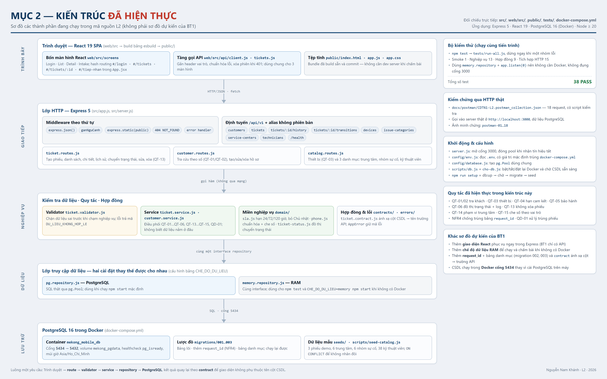

# MỤC 2 — Kiến trúc đã hiện thực (1 trang)

Ảnh sơ đồ: **`docs/export/kien-truc-thuc-te.png`** (nguồn vẽ: `docs/kien-truc-thuc-te.html`).

Đây là sơ đồ **các thành phần đang có trong mã nguồn**, đối chiếu trực tiếp với
`src/`, `web/src/`, `public/`, `tests/` và `docker-compose.yml` — không phải sơ đồ
dự kiến của BT1.

## Các tầng và tệp tương ứng

| Tầng | Thành phần thực tế | Tệp |
|---|---|---|
| Trình bày | React 19 SPA, 4 màn hình, hash routing; bundle build sẵn | `web/src/screens/*.jsx`, `web/src/App.jsx`, `web/src/api/*.js` → `public/app.js`, `public/app.css`, `public/index.html` |
| Giao tiếp | Express 5: middleware theo thứ tự, route `/api/v1` + alias, static, 404, error handler | `src/app.js`, `src/server.js`, `src/routes/*.routes.js`, `src/middleware/ngu-canh.js` |
| Nghiệp vụ | Validator → Service → miền nghiệp vụ (SLA, số điện thoại, đồ thị trạng thái), hợp đồng dữ liệu, mã lỗi | `src/validators/ticket.validator.js`, `src/services/*.js`, `src/domain/*.js`, `src/contracts/ticket.contract.js`, `src/errors/AppError.js` |
| Dữ liệu | Hai cài đặt repository cùng interface, chọn bằng `CHE_DO_DU_LIEU` (`postgresql` mặc định, `memory` khi không có Docker) | `src/repositories/pg.repository.js`, `src/repositories/memory.repository.js` |
| Lưu trữ | PostgreSQL 16 trong Docker, cổng 5434 → 5432, volume `mekong_pgdata`; 3 migration + seed | `docker-compose.yml`, `migrations/001…003`, `seeds/001_seed_demo.sql`, `scripts/seed-catalog.js` |
| Kiểm thử | `npm test` → 4 nhóm, 38 test, chạy cùng tiến trình với repository RAM | `tests/run-all.js`, `tests/smoke-test.js`, `tests/ticket.service.test.js`, `tests/ticket.contract.test.js`, `tests/api.e2e.test.js` |

## Luồng một yêu cầu

`Trình duyệt` → `route` (kiểm tra hình dạng, gắn ngữ cảnh vai trò) → `validator`
(chặn dữ liệu sai) → `service` (áp quy tắc QT-01…QT-15, QD-01) → `repository`
(SQL hoặc RAM) → `PostgreSQL`. Kết quả đi ngược lại qua `contract` để giao diện
không phụ thuộc tên cột CSDL.

## Khác so với sơ đồ dự kiến của BT1

| Điểm | BT1 (dự kiến) | L2 (đã hiện thực) |
|---|---|---|
| Giao diện | Chỉ có API | Thêm React 19 phục vụ ngay trong Express, không cần dev server |
| Kho dữ liệu | Chỉ PostgreSQL | Thêm `memory.repository` cùng interface để chạy/chấm khi không có Docker |
| CSDL | Cài PostgreSQL trên máy | PostgreSQL 16 trong Docker, cổng **5434** để không đụng 5432 |
| Chống trùng | Chưa có | `request_id` + migration `002`, trả 200 với `la_phieu_cu` khi gửi lại |
| Danh mục | Chưa có | Migration `003`: trung tâm, nhóm sự cố, kỹ thuật viên |
| Hợp đồng dữ liệu | Trả thẳng cột CSDL | `ticket.contract.js` ánh xạ cột → trường API, có test hợp đồng |

## Vì sao kiến trúc này

- **Ba lớp tách rời** để quy tắc nghiệp vụ kiểm thử được mà không cần CSDL: 38 test
  chạy trong vài giây, không cần Docker.
- **Hai cài đặt repository** giữ nguyên interface nên `npm start` và `npm test`
  dùng chung một tầng nghiệp vụ — đánh đổi là phải viết SQL hai lần cho cùng một
  truy vấn khi thêm tính năng mới.
- **`createApp()` không mở cổng**, `server.js` mới mở cổng 3000: nhờ vậy test
  dùng `app.listen(0)` và không xung đột với server đang chạy khi chấm bài.
